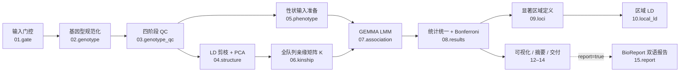

# GWASFlow


来源声明：本工程基于 [FlowFrame](https://github.com/CygnusX-Labs/FlowFrame)（commit `24a0cd3e`，框架规范 v2.0）构建，遵循 Flow 家族工程规范（入口九步初始化、配置四件套、TargetPlan 纯函数目标生成、资源档位、日志降级链与复制交付契约）。框架扩展声明见 [docs/FLOWFRAME_VARIANT_PROFILE.md](docs/FLOWFRAME_VARIANT_PROFILE.md)。

植物二倍体、硬分型双等位 SNP、连续数量性状的 **GEMMA LMM 全基因组关联分析流程**（多性状独立分析）。染色体对数、参考版本与 15 个模块开关全配置化；产出含静态发表图、交互式探索图与 BioReport 双语（中/英）HTML+PDF 报告。

## 特性亮点

- **两条基因型入口**：VCF/BCF（bcftools 规范化链）或 PLINK BED（variant_map 身份对账，不盲猜 REF/ALT）
- **四阶段基因型 QC**：pre-geno → mind → geno/maf/mac 独立执行，每阶段剔除集合留痕可对账；自交/近交植物默认关 HWE、保留高亲缘材料
- **完整 LMM 关联链**：LD 剪枝 PCA（与关联标记集用途隔离）→ 全队列 centered K → GEMMA `-lmm`（wald/lrt/score 预声明）→ 统一统计（身份强校验 + Bonferroni + 精确 MAC）
- **位点与区域**：lead 选取（阈值唯一来源 metadata）→ LD clump → 区域成对 LD（r²/dprime）
- **三层可视化**：静态 svg/pdf/png（发表）+ plotly WebGL 交互 HTML（探索，全量渲染可悬停）+ BioReport 双语报告（HTML+PDF）
- **诚实语义**：无基线不冒称 verified、partial 不写 complete、无显著位点是合法结果、渲染器缺位显式报错而非静默降级

## 分析流程总览



规则编号 ≠ 执行顺序（如 `04.phenotype_qc` 在 `n_pcs>0` 时依赖 `05.population_structure` 的 PCA 产物）。全部 21 条规则的输入/处理/输出见各 `.smk` 文件 docstring（Input/Process/Output 三段式）。

## 适用边界

| | |
| --- | --- |
| **支持** | VCF/BCF（含索引）或 BED 三件套（+已核验 variant_map）、材料级连续数量性状、Wald/LRT/score 预声明主检验、全队列 K + 性状缺失掩码路线、静态与交互图、BioReport 报告 |
| **不支持（启用即报错）** | LOCO、FarmCPU/BLINK、基因型填充、多环境联合模型、人类 GWAS profile、PGEN/HapMap 导入、大规模流式统计引擎、完整 FlowAgent 入库 |
| **规模边界** | 统一统计面向小/中规模内存排序（实测 214k 位点 × 194 样本正常）；大规模流式（BGZF/Tabix/Parquet）为后续扩展 |

## 目录结构

```text
GWASFlow/
├── snakefile                 # 入口（小写，自动发现）：九步初始化
├── config/                   # 配置四件套（config/reference/run_parameter/cluster_config）
├── schema/config.schema.yaml # 全键校验 + 未实现功能拒绝分支
├── rules/                    # 01..15 模块化规则（编号≠执行顺序）
│   └── utils/                # TargetPlan 纯函数、收集器、校验工具
├── scripts/                  # 20 个 CLI（18 Python + 2 R；参数契约见 docs/SCRIPT_PARAMETERS.md）
├── envs/                     # 7 个 conda 环境声明（--use-conda 按规则自动创建）
├── examples/                 # 配置覆盖示例 + 七类表格模板
├── tests/                    # L1/L2/L3 分层测试（覆盖 18 验收场景）
├── data/AtPolyDB_GWASFlow_Test/  # 拟南芥真实数据测试包（含一键准备脚本与快照校验）
└── docs/                     # 实现文档/参数手册/测试指南/验收记录
```

## 快速开始

### 0. 前置依赖

| 依赖 | 用途 | 安装 |
| --- | --- | --- |
| Python 3.10+ / [uv](https://docs.astral.sh/uv/) | 调度环境 | 系统包管理器或 `curl -LsSf https://astral.sh/uv/install.sh \| sh` |
| snakemake ≥ 9.9.0 | 流程引擎 | 随 `.testenv` 安装（见下） |
| mamba / conda | `--use-conda` 环境创建 | `conda install -n base -c conda-forge mamba` |
| snakemake-logger-plugin-rich-loguru | `--logger rich-loguru` 面板日志 | `uv pip install <本地源码路径>` 或 PyPI；未装时代码三级降级兜底 |
| quarto + bioreport | 仅 `report: true` 时需要 | `pip install -e /path/to/bioreport`；缺位时规则显式报错（exit 2），不静默降级 |

外部分析软件（GEMMA/PLINK/bcftools/R）**无需手动安装**——方式 A 由 `--use-conda` 自动创建；方式 B 也可直接使用 PATH 中已有的工具。

### 1. 调度环境

```bash
uv venv .testenv --python 3.12
uv pip install --python .testenv/bin/python pytest pyyaml "snakemake>=9.9.0"
# 可选：rich-loguru 日志插件（本地源码示例）
uv pip install --python .testenv/bin/python /path/to/snakemake-logger-plugin-rich-loguru
```

### 2. 项目配置（analysisyaml）

复制 [examples/analysisyaml.example.yaml](examples/analysisyaml.example.yaml) 到项目工作目录（如 `/data/project/01.workflow/analysis_config.yaml`），按段编辑。**全部路径必须为绝对路径**（样本表解析发生在 workdir 重定向前）。

<details>
<summary><strong>配置字段速查（点击展开）</strong></summary>

| 段 | 字段 | 说明 |
| --- | --- | --- |
| 元数据 | `project_name` / `Genome_Version` / `species` | Genome_Version 须在 `can_use_genome_version` 清单内 |
| 输入表 | `sample_csv` / `phenotypes_tsv` / `traits_tsv` / `covariates_tsv` | 契约见下方"输入契约"；covariates 可为 `null`（无协变量项目） |
| 基因型 | `genotype_format`: `vcf`/`bcf`/`bed` | VCF 用 `genotype_input`；BED 用 `genotype_bfile` 前缀 + `input_variant_map` |
| 完整性 | `expected_checksums_tsv` / `checksum_mode: auto` | 无基线时门控标注 `baseline_only`（不冒称 verified） |
| 工作区 | `workflow` / `data_deliver` | 全部产物目录的根；建议 `01.workflow` / `02.data_deliver` |
| 执行 | `execution_mode: local` / `queue_id` | 集群档位见 `config/cluster_config.yaml` |
| 开关 | `only_qc` / `deliver` / `report` / `local_ld` / `candidate_genes` … | 15 个开关在 `config/config.yaml` 有显式默认值；`report` 默认 false |
| 参数 | `parameter:` 段 | 覆盖默认阈值（见下方参数参考） |
| 参考 | `GWAS_reference.<版本>` | FASTA/GFF3/染色体表等按需校验（BED 路线不要求 FASTA） |

</details>

BED 路线的真实数据配置模板见 [tests/atpolydb/analysisyaml.atpolydb_smoke.yaml](tests/atpolydb/analysisyaml.atpolydb_smoke.yaml)（smoke 子集）与 [tests/atpolydb/analysisyaml.atpolydb_full.yaml](tests/atpolydb/analysisyaml.atpolydb_full.yaml)（完整集）。

### 3. dry-run 验证

```bash
snakemake --cores 100 --conda-frontend mamba --use-conda --logger rich-loguru \
    --config analysisyaml=/data/project/01.workflow/analysis_config.yaml -n
# 控制台会打印生效模块开关清单与自动启用原因
```

### 4. 提交运行

```bash
# 本地（推荐提交格式）
snakemake --cores 100 --conda-frontend mamba --use-conda --rerun-triggers mtime \
    --logger rich-loguru \
    --config analysisyaml=/data/project/01.workflow/analysis_config.yaml \
    --rerun-incomplete

# 集群（示例 slurm；资源档位见 config/cluster_config.yaml）
snakemake --cores 100 --executor slurm --use-conda --conda-frontend mamba \
    --logger rich-loguru \
    --config analysisyaml=/data/project/01.workflow/analysis_config.yaml \
    --default-resources slurm_account=your_account
```

要点：

- `snakefile` 为小写且可自动发现，无需 `-s`
- 首次运行自动创建 5 个 conda 环境（约 2.2GB，缓存在 `<workflow>/.snakemake/conda/`）
- 中断恢复：原命令重跑即可（`--rerun-incomplete` 清理不完整产物；已成功产物不清空）
- 两种部署模式（`--use-conda` 与 PATH 直连）结果一致（已实测：gwas.tsv 指纹相同）

### 5. 常用变体

```bash
# only_qc：只跑门控+规范化+QC（analysisyaml 设 only_qc: true）
# 单目标：仅重跑某性状统一统计
snakemake --cores 8 --config analysisyaml=... 08.results/FT10/gwas.tsv
# 报告：analysisyaml 设 report: true 后
snakemake --cores 8 --config analysisyaml=... 15.report/report_manifest.json
```

## 输入契约

四类表格的列契约（模板见 [examples/tables/](examples/tables/)；违规在门控阶段被拒绝并指明列名）：

| 文件 | 分隔 | 列 | 说明 |
| --- | --- | --- | --- |
| `samples.csv` | 逗号 | `sample, fid, iid, include` | `include=true` 纳入；样本身份 = (fid, iid) |
| `phenotypes.tsv` | TAB | `sample` + 每性状一列（列名 = traits 的 `phenotype_column`） | 缺失以 `NA` |
| `traits.tsv` | TAB | `trait, phenotype_column, trait_type, unit, transform, primary_model, numeric_covariates, categorical_covariates, n_pcs` | 每行一个性状；`n_pcs` 为纳入模型的 PC 数 |
| `variant_map.tsv`（BED 路线必配） | TAB | `variant_id, original_id, chrom, engine_chrom, pos, ref, alt` | **variant_id 必须登记为 BIM 的 SNP ID**；A1/A2 为观测等位基因，无 REF/ALT 断言（生成器见 `tests/atpolydb/make_variant_map_from_bim.py`） |
| `chromosome_table.tsv` | TAB | `chrom, length_bp` | 绘图 x 轴基因组坐标与染色体顺序的唯一来源 |

## 产物地图

全链产出 15 个目录（均在 `workflow:` 指向的工作区根下）：

| 目录 | 内容 | 关键产物 |
| --- | --- | --- |
| `01.gate/` | 输入门控 | `input_gate.json`（三态 MD5）、`md5_check.tsv`、`reference_check.json` |
| `02.genotype/` | 规范化 | `raw_engine.{bed,bim,fam}`、`variant_map.tsv`、`normalize_audit.json` |
| `03.genotype_qc/` | 四阶段 QC | `cohort.{bed,bim,fam}`（FAM 顺序=全流程对齐权威）、`stage{1,2,3}.stats.tsv`、`removed_*.tsv`、`qc_audit.json` |
| `04.structure/` | 群体结构 | `pca_prune.{prune.in,prune.out}`、`pca.{eigenvec,eigenval}` |
| `05.phenotype/{trait}/` | 性状准备 | `phenotype.gemma.txt`、`covariates.gemma.txt`、`keep.tsv`、`metadata.json` 等八件 |
| `06.kinship/` | 亲缘矩阵 | `kinship.cXX.txt`（或 sXX）、`sample_order.tsv`、`kinship_validation.json` |
| `07.association/{trait}/` | 关联检验 | `association.assoc.txt`、`run_metadata.json`（含可复现 GEMMA 命令）、`gemma.help.txt` |
| `08.results/{trait}/` | 统一统计 | `gwas.tsv`、`significant.tsv`、`unreported_variants.tsv`（与 QC 剔除集可对账）、`metadata.json` |
| `09.loci/{trait}/` | 区域定义 | `lead.tsv`、`loci.tsv`、`locus_manifest.json` |
| `10.local_ld/{trait}/` | 区域 LD | `regional_ld.tsv`、`regional_ld_status.tsv`（工具失败透明记录）、`ld_index.json` |
| `11.candidates/{trait}/` | 候选基因 | `candidates.tsv`（须配 GFF3 并启用 `candidate_genes`） |
| `12.plots/` | 可视化 | 静态 `manhattan/qq.{svg,pdf,png}`、交互 `manhattan/qq_interactive.html`、`diagnostics/pca.png`+`kinship_heatmap.png`、`plot_manifest.json` |
| `13.summary/` | 摘要 | `project_summary.json`（七类审计）、`artifact_index.tsv`、`effective_config.yaml` |
| `14.data_deliver/` | 交付 | `delivery_manifest.{json,md5}` + 可独立移动的 `analysis_results/` 树 |
| `15.report/` | 报告（`report: true`） | `report_config.json`、`report_output/*_report.html`（中英合并）、`*_report.pdf`、`*_report.en.pdf`、`report_manifest.json` |

## 参数参考（`parameter:` 段，默认值）

| 组 | 参数（默认值） |
| --- | --- |
| `qc` | `chr_count`（9，占位）、`pre_geno` 0.20、`mind` 0.10、`geno` 0.10、`maf` 0.05、`mac` 5、`memory_mb` 8000、`min_samples_after_qc` 20、`dp_min`/`gq_min` null |
| `structure` | `prune_window_kb` 50、`prune_r2` 0.20、`pca_components` 10（kb 窗口下 plink2 强制 step=1，`prune_step` 仅标记数窗口模式适用） |
| `kinship` | `type` centered（GEMMA `-gk 1`；standardized=`-gk 2`）、`mode` genome_wide |
| `association` | `primary_test` wald（wald/lrt/score/all）、`maf` 0.05、`miss` 0.10 |
| `multiple_testing` | `alpha` "0.05"、`family_size` 1（阈值 = alpha/(family_size×M)，M=该性状有效 P 数） |
| `loci` | `clump_r2` 0.20、`clump_kb` 500、`region_boundary` ld、`fallback_flank_bp` 50000 |
| `local_ld` | `metric` r2（r2/dprime）、`maf` 0.05、`missing_max` 0.10、`max_regional_plots` 20 |
| `plotting` | `formats` svg,pdf,png、`point_budget` 200000、`max_render_points` 2000000、`plotlyjs` embed、`p_zero_display_cap` "1e-300" |

单位契约（比例/kb/bp/计数）见 [docs/SCRIPT_PARAMETERS.md](docs/SCRIPT_PARAMETERS.md) §10。

## 测试与验证状态

```bash
.testenv/bin/python -m pytest tests/test_unit.py -q    # L1 单元（46 项）
bash tests/test_dag.sh                                 # L2 DAG（21 项）
bash tests/test_behavior.sh                            # L3 mock 端到端（25 项）
```

覆盖矩阵见 [tests/coverage_matrix.md](tests/coverage_matrix.md)（18 个验收场景）。真实数据验收（AtPolyDB，拟南芥 TAIR9）：

| 项 | 结果 |
| --- | --- |
| 全链运行 | smoke（194×10,703）与完整集（194×214,051）均 100%；FT10 在 **FRI 区域**复现 Bonferroni 显著主效位点（chr4:6,682,595，p=1.15e-7） |
| 口径 A 数值对账 | 独立 GEMMA 同参数复现：smoke 逐位一致；完整集 203,813 值仅 1 个 P 相对偏差 4.77e-07（GEMMA 运行间浮点抖动，<1e-6 容差）；独立 K 矩阵逐位一致 |
| 口径 C QC 对账 | 四阶段剔除集合逐阶段一致 |
| 部署模式 | `--use-conda` 与 PATH 直连 gwas.tsv 指纹一致 |
| 软件版本（实测） | GEMMA 0.98.5、PLINK 1.9.0-b.7.11、PLINK 2.0.0-a.7.x、R 4.5.x、bcftools 1.22 |

复现步骤见 [docs/ATPOLYDB_TEST_GUIDE.md](docs/ATPOLYDB_TEST_GUIDE.md)（Step 0–7）；完整台账见 [docs/VALIDATION.md](docs/VALIDATION.md)。

## 报告与交互图

- **交互图**（每性状自动产出）：`12.plots/{trait}/manhattan_interactive.html` 与 `qq_interactive.html`。plotly WebGL 全量渲染（悬停查看 variant_id/P/beta，缩放/框选/套索，可导出 PNG），HTML 内嵌 plotly.js **离线双击即可打开**；超 `max_render_points`（默认 200 万）才抽样且显著点全保留（seed 可复现，副标题记录审计）。
- **BioReport 双语报告**（`report: true` 时）：`15.report/report_output/` 产出中英合并 HTML（内置语言切换）与中/英两份 PDF（专业封面 + 矢量图表）。报告模块集 `gwas.index/workflow/qc/results(.manhattan/.significant/.structure)`，配置由 `scripts/export_report_config.py` 从工作区产物自动导出（性状、软件版本、染色体表零手工填写）。渲染引擎（quarto + bioreport）缺位时显式报错，不静默降级。

## 故障排查（FAQ）

| 现象 | 原因与处理 |
| --- | --- |
| `--use-conda` 报 `PackagesNotFoundError: plink2` | 环境声明写 `plink2>=2.0` 所致——bioconda 的 plink2 版本号为 `2.00aX` 预发布格式，conda 语义下全部 `< 2.0`。本仓库已改裸包名；自写 env 文件同样注意 |
| conda 拉取极慢或 SSL 失败 | 检查 `~/.condarc` 的镜像频道可用性（如失效的 menpo 频道会拖垮全部事务），或临时 `--override-channels` 指定可用频道 |
| harmonize 全量报"等位基因不匹配" | GEMMA 0.98.x 第二等位基因列名为 `allele0`（非 `allele2`）；本仓库已兼容。使用旧版 GEMMA 输出或第三方重解析时留意列名 |
| `--indep-pairwise` 退出码 8 | plink2 规定 kb 窗口 step 必须为 1；本仓库已按 `<N>kb <r2>` 传参 |
| 区域 LD 状态全是 failed | plink2 ≥ a.7 已拆分 `--r2` → `--r2-unphased` / `--r2-phased cols=+dprimeabs`，输出 `.vcor`；本仓库已适配新版，若混用旧版 plink2 需核对 `10.local_ld/{trait}/regional_ld_status.tsv` |
| PCA 图静默缺失 | plink2 eigenvec 表头带 `#` 前缀，旧读取逻辑会整行吞掉；已修复。排查同类问题先看 `12.plots/plot_manifest.json` 与 `logs/12.visualization/` |
| 样本计数异常（FID=0） | PLINK 可能把 FID=0 视为缺失家系；流程已固定 `--nonfounders` 纳入全部材料统计 |
| 任务中断后重跑 | 原命令加 `--rerun-incomplete`；已成功产物不清空，仅续跑未完成部分 |

## 重要声明

- **QC 默认阈值（mind=0.10/geno=0.10/maf=0.05/mac=5）为审阅起点，非普适植物标准**；自交/近交植物默认关闭 HWE 过滤、不自动删除高亲缘材料（块状高 K 由 LMM 随机效应吸收）。
- 生菜示例值（染色体 9 对、`Lsat_Salinas_v11`）为占位：部署前必须核对真实组装与 `chr_count`。
- BED 路线不盲猜 REF/ALT：variant_map 登记的是观测等位基因（约定 ref=A2/alt=A1 或字典序），效应方向以 GEMMA allele1（reported）为准，`target_effect_allele` 可选 `alt` 翻转。
- 交互图为探索用途、静态三格式为发表用途；两者阈值/下溢语义一致（阈值唯一来源 metadata，P=0 显示上限不改统计表）。
- 无显著位点是合法科学结果，报告与统计表如实呈现。
- `15.Report` 渲染引擎缺位时 exit 2 显式报错（能力边界：结构化摘要 + 静态/交互图表）。

## 文档索引

| 文档 | 内容 |
| --- | --- |
| [docs/GWASFlow_IMPLEMENTATION.md](docs/GWASFlow_IMPLEMENTATION.md) | 核心实现文档（链路/规则清单/方法约束） |
| [docs/SCRIPT_PARAMETERS.md](docs/SCRIPT_PARAMETERS.md) | 脚本参数与软件命令手册（CLI 契约、单位契约） |
| [docs/FRAMEWORK_ALIGNMENT.md](docs/FRAMEWORK_ALIGNMENT.md) | 框架对齐调查与 M1–M7 缺失信息 |
| [docs/FLOWFRAME_VARIANT_PROFILE.md](docs/FLOWFRAME_VARIANT_PROFILE.md) | input_profile=variants 框架扩展声明 |
| [docs/ATPOLYDB_TEST_GUIDE.md](docs/ATPOLYDB_TEST_GUIDE.md) | AtPolyDB 真实数据 L4/L5 验收指南（分步命令） |
| [docs/HANDOVER.md](docs/HANDOVER.md) | 通用交接文档（L1–L5 验收路径与风险区） |
| [docs/VALIDATION.md](docs/VALIDATION.md) | 验收记录（对账结果/版本台账/未验证项） |
| [tests/README.md](tests/README.md) | 分层测试运行入口与未验证项清单 |

## 来源与致谢

- 框架：[FlowFrame](https://github.com/CygnusX-Labs/FlowFrame)（CygnusX-Labs）· 报告引擎：[BioReport](https://github.com/xsx123123/bioreport)（Quarto 多组学报告）
- 验收数据：AtPolyDB（[Gregor-Mendel-Institute/atpolydb](https://github.com/Gregor-Mendel-Institute/atpolydb)），拟南芥 250k SNP TAIR9 矩阵与 Atwell et al. 2010 发布表型（快照经 SHA256SUMS 锁定）
- 工具链：[GEMMA](https://github.com/genetics-statistics/GEMMA)、[PLINK 1.9/2.0](https://www.cog-genomics.org/plink/)、[bcftools](https://samtools.github.io/bcftools/)、[plotly.py](https://plotly.com/python/)（交互图参照其 Manhattan 教程）
